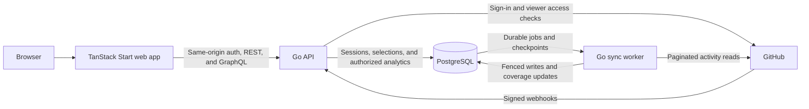

# RepoOrbit

RepoOrbit is a GitHub workspace for understanding repository activity, finding contribution opportunities, and tracking delivery. Connect repositories you own or follow repositories you have starred. The workspace brings together issues, pull requests, reviews, contributor participation, and release history, with links back to the relevant GitHub records.

## Repository intelligence

- **Engineering overview** summarizes selected repositories and surfaces PRs awaiting review, issues without a response, stale open issues, failed workflow runs, and work assigned to you, alongside overall build success rate.
- **Repository workspace** shows 7-, 30-, and 90-day metrics, a pull request list, contributor activity, a timeline of merges, releases, and issue events, an issue Board, and GitHub Actions health.
- **Repository selection** lets you choose what to sync. GitHub sign-in identifies the viewer, and GitHub App installations grant access to selected private repositories. Each viewer controls their own selection.

Metrics carry coverage information. An unfinished import leaves an unknown value where history is incomplete. The timeline marks gaps in recorded events, and contributor views distinguish human participation from bot activity.

## Architecture



The web app uses TanStack Start and React for navigation, shadcn/ui and Tailwind CSS for components, TanStack Query for fetching and polling, TanStack Table for tabular views, and ECharts for activity charts. Its server proxies requests to Go on the same origin. The Go API manages sessions, repository selection, webhooks, and GraphQL queries. PostgreSQL stores selections, jobs, imported GitHub activity, and coverage checkpoints. SQL queries compute analytics from the stored activity.

### Synchronization and access

1. Connecting or following a repository records the selection and schedules background work. Workers claim jobs by renewable lease and resume imports from saved cursors. Stable GitHub IDs let a retried page update existing records.
2. The worker tracks issues, PRs, reviews, comments, releases, and issue events separately. A stalled import can leave one metric incomplete while other data remains readable. Signed webhooks trigger reconciliation, and periodic polling catches missed changes.
3. Eligible activity imports use short-lived GitHub App installation tokens. The viewer's token handles access checks and public activity imports outside the installation. Rate limits defer work until the next retry.
4. GraphQL checks viewer access before reading repository data. An access fence detects permission changes during reads and prevents in-flight jobs from committing against outdated permissions. After a temporary connection failure or rate limit, a workspace the viewer already loaded can show a read-only snapshot with its timestamp and the reason it is frozen.

### Issue management, discovery, and delivery

The application architecture uses GitHub as the source of truth for issue management, discovery, and delivery.

| Area | Data and permission model |
| --- | --- |
| **Issue management and Board** | Tasks map to GitHub issues. Board columns come from a repository's status labels (`status:todo`, `status:in-progress`, `status:review`); repositories without them show issues under "No status source". Only Admin or Maintain users turn status labels on, which creates any missing labels through review, or off. When an issue closed on GitHub keeps a status label, the GitHub App removes it during sync where the installation has Issues write, and records the removal as its own. Issue edits and card moves go through review, user-attributed submission, and confirmation. An idempotency key identifies each submission. An uncertain result keeps the draft and operation record available for reconciliation before another attempt. |
| **Contribution discovery** | Recommendations draw from accessible repositories the viewer has explicitly followed from their stars. Matching uses skill and interest preferences, difficulty labels, issue availability, and repository responsiveness. Matches explain their evidence and freshness. Saved and dismissed issues are scoped to the viewer. |
| **Delivery monitoring** | Read-only GitHub Actions data supplies run and job status, success rates, p50/p95 durations, queue wait, and failures by workflow. Confirmed GitHub links connect an issue to its PR, review state, checks, and deployment, and each failed check leads to its job and GitHub logs. Deployment history comes only from GitHub Deployment records; without them, deployment data is shown as unavailable. |

## Run locally

With Docker Compose, start the database, API, worker, and web app:

```sh
docker compose up --build
```

Open [RepoOrbit](http://localhost:3000). With GitHub credentials unset, the app runs in Demo mode against seeded PostgreSQL data. The database persists in a Docker volume.

### Connect GitHub

1. Register a GitHub App. Use `http://localhost:3000/auth/github/callback` as its authorization callback and `http://localhost:3000/auth/github/installed` as its setup URL. Enable expiring user tokens and redirect on update, leave "Request user authorization (OAuth) during installation" unticked, and allow installation on any account.
2. Grant the app repository **Issues** read and write access, **Pull requests**, **Contents**, **Actions**, and **Deployments** read access, and account **Starring** read access. **Projects** access is requested only when a maintainer links a GitHub Project. Install the app on the repositories you want it to cover.
3. Copy `.env.example` to `.env` and set `GITHUB_CLIENT_ID`, `GITHUB_CLIENT_SECRET`, and `GITHUB_APP_SLUG`. Store the private key in `secrets/` and set `GITHUB_APP_PRIVATE_KEY_FILE` to its path under `/run/repoorbit-secrets/` inside Compose.
4. Set `TOKEN_ENCRYPTION_KEY` to 32 random bytes encoded in base64 and set `WEBHOOK_SECRET` to a random secret. To receive GitHub events, configure the app webhook to send to a reachable API URL ending in `/webhooks/github` and use the same secret on both sides.
5. Restart Compose and sign in through the same origin you configured in `APP_URL`. Keep `.env` and the private key local.

## Development

| Path | Responsibility |
| --- | --- |
| [`apps/web/`](apps/web/) | Routes, repository workspaces, charts, and the same-origin proxy |
| [`backend/cmd/`](backend/cmd/) | Go API and worker entry points |
| [`backend/graphql/`](backend/graphql/) | GraphQL schema, access checks, and analytics resolvers |
| [`backend/internal/ingestion/`](backend/internal/ingestion/) | Activity imports, reconciliation, and cleanup |
| [`backend/migrations/`](backend/migrations/) and [`backend/queries/`](backend/queries/) | PostgreSQL schema and sqlc queries |

Use Go 1.24 and Bun 1.4.5 for local development. Bun installs web dependencies with `bun install --frozen-lockfile` in `apps/web`. It runs Vite and the production web server (`server.mjs`). Node 22 is still needed only for Playwright, ESLint and tsc. Run `make check` for static checks and builds, `make test` for Go unit tests, and `make test-integration` with the Compose database running. Install Chromium with `./node_modules/.bin/playwright install chromium` from `apps/web` to run `make test-e2e`. The `make test-e2e-auth` target exercises sign-in and repository access against a fake GitHub server.
