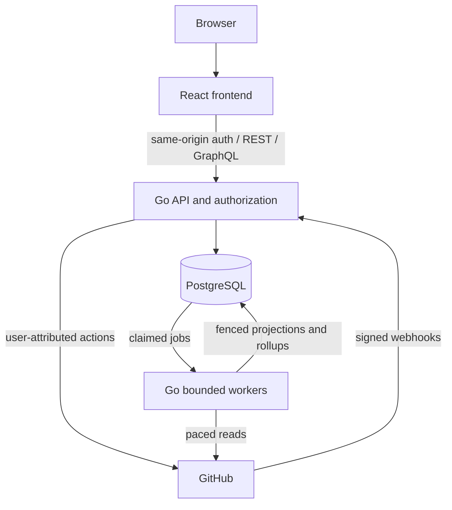
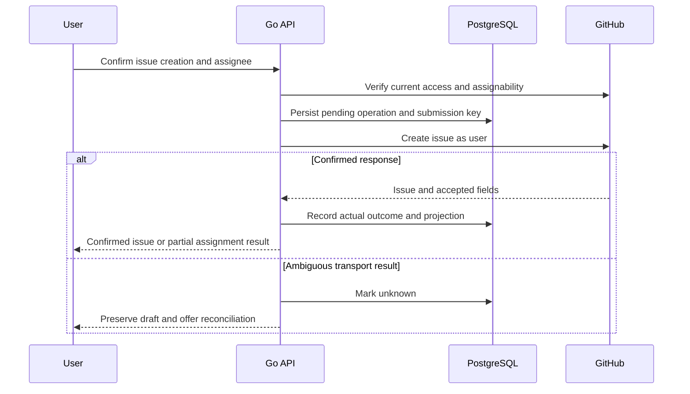
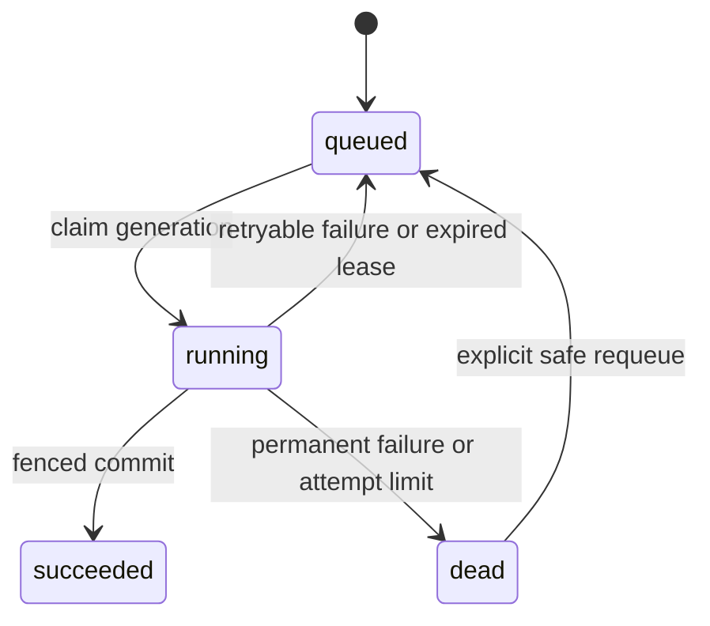

# RepoOrbit Repository Intelligence - Plan

## Goal Capsule

- **Objective:** Developers can understand what is happening across their repositories, judge a project's activity, find an issue they can contribute to, assign GitHub issues to teammates, plan those issues on a Board, and monitor GitHub Actions delivery.
- **Means:** A local Go/PostgreSQL application with a React frontend, GitHub integration, shared repository pages, SQL analytics, and explainable rule-based ranking (KTD1–KTD8).
- **Authority:** The Product Contract captures the conversation's final decisions and supersedes conflicting product assumptions in the supplied `GITHUB_ENGINEERING_INTELLIGENCE_PROPOSAL.md`. Retain that proposal's stack and sequential delivery strategy; this document is self-contained.
- **Execution profile:** Deliver one phase at a time, leaving a runnable slice at each gate. The first implementation engagement covers Phase 0 / U1 only; later phases require an explicit continuation instruction.
- **Stop conditions:** Stop for a requirement that needs broader GitHub access than documented, a permission/privacy failure, or a scope change. Missing credentials block live verification, not demo development.
- **Tail ownership:** The implementer owns migrations, generated contracts, UI integration, documentation, and evidence for the active unit. No deployment or publishing is authorized by this plan.

---

## Product Contract

### Summary

RepoOrbit provides an overview of the user's repository activity and a shared workspace for every accessible repository. Each workspace combines project activity, contributor participation, recent changes, contribution opportunities, and the issue actions the signed-in user is allowed to perform.

### Problem Frame

The user has difficulty finding issues they can meaningfully solve and determining whether a project is still active. They also want to see who contributed recently, how a repository has changed, what is stalled, and what is happening across their own repositories.

### Requirements

**Repository access and navigation**

- R1. Provide one repository experience for all authorized viewers; available actions depend on current GitHub permissions, not a product mode or ownership category.
- R2. Provide a paginated My Repositories overview with per-repository activity summaries and drill-down. Include repositories returned by GitHub as owned by the signed-in personal account; the user selects which to connect for synchronization. Selection uses checkboxes: on first use nothing is pre-checked, checking and unchecking are free until the user confirms, and confirming starts synchronization for the checked repositories. Later, the Repositories page uses the same list with a pending-changes bar (to add, to remove, Apply, Discard) and explains before applying that removal stops the user's synchronization, keeps saved issues while access lasts, and leaves other users' selections untouched. Each repository reports its own result; one failure does not undo the others.
- R3. Let users browse their authenticated starred list and explicitly select repositories to follow for contribution discovery. Following uses the same checkbox selection as R2 and schedules the same analytics synchronization as connecting; public and authorized private repositories are supported.
- R4. Recheck repository visibility and user access for private reads and every write. Deny access when permissions are revoked or cannot be verified, including saved items, timeline entries, aggregate results, and recommendations.

**Repository intelligence**

- R5. In both the overview and repository workspace, show activity and responsiveness, bottlenecks, and contributor participation over 7/30/90-day windows. Present measurements as activity indicators rather than productivity rankings.
- R6. Show a chronological timeline of merged PRs, published releases, and issue activity, including the actor, time, and GitHub link. Historical gaps must be visible; a missing event history must not be synthesized as observed fact.
- R7. Show synchronization age, coverage, loading/partial-data, empty, and error states. Never represent demo fixtures or incomplete history as current GitHub data.

**Contribution discovery**

- R8. Recommend eligible open issues only from the user's selected starred repositories that are still accessible and starred according to the latest completed star refresh. Support private candidates under R4, and exclude dismissed issues, archived repositories, known assignees, and reliably identified linked work already resolving the issue.
- R9. Use explicit skills, interests, and optional difficulty preferences to explain matches, with a feature breakdown and freshness. Missing metadata is uncertainty, and an unassigned issue is not a guarantee it is available.
- R10. Support save, dismiss, and open-on-GitHub actions. Saved issues remain viewable after deselection while R4 permits access, with current state/freshness; deselected issues stop appearing as recommendations.

**Teammate tasks**

- R11. Tasks are GitHub issues. Allow authorized users to create issues with title/body and optional supported labels/assignees, update labels/assignees, and close/reopen issues from the workspace.
- R12. Offer only GitHub-eligible assignees and verify the resulting assignment before reporting success. Make user-initiated writes reviewable before submission, and keep an actor-linked operation history with requested changes and actual outcomes.
- R13. Preserve the draft and operation status after a write fails or its outcome is ambiguous. A retry must not silently create duplicate issues or replace unrelated labels/assignees.

**Delivery**

- R14. Support Docker Compose startup with a database-backed, clearly labeled demo when GitHub credentials are absent. Credentialed operation uses the same application path with real authorization enabled.

**Board and delivery monitoring**

- R15. Show a Board of GitHub issues inside each repository workspace, with Board and List views and assignee, label, and text filters. There is no cross-repository Board; instead the overview's "Assigned to me" list (open issues assigned to the user across selected repositories) is grouped by status and opens the task drawer. Columns come only from the repository's status source: a linked GitHub Project's Status field, or configured status labels (Backlog = open with no status label, Done = closed). Repositories without a status source appear under "No status source"; open/closed state alone never decides a column.
- R16. Moving a card, or changing status, assignee, or open state from the Board, is a GitHub write under R12–R13. It shows as pending until GitHub confirms and is rolled back and resynced on failure. Only users with Admin or Maintain permission on a repository may change its status source; creating status labels is reviewed before submission; the Projects permission is requested only when someone links a Project.
- R17. Monitor GitHub Actions read-only inside each repository workspace, with the overview showing failing workflows and overall success rate and listing failed runs under Needs attention. Over 7/30-day windows show: success rate, failed and running jobs, and p50/p95 duration from run and job timestamps (P0); queue wait, failure by workflow, and deployment history (P1).
- R18. In one panel, show an issue's confirmed linked PR, its review state, CI checks, and Deployment, with each failed check leading to its job and GitHub logs. Show a Deployment only from GitHub Deployment records; when none exist, say the data is unavailable instead of treating a successful workflow as a deployment.

### Key Decisions

- **Shared workspace with permission-based actions.** Governs R1, R4, R11. (session-settled: user-directed — chosen over separate ownership/contribution modes: the repository experience stays the same and capabilities follow the person.)
- **Explicit starred selection and bounded recommendations.** Governs R3, R8. (session-settled: user-directed — chosen over importing all stars or broader discovery: the user chooses repositories they want to contribute to.)
- **Public and private support.** Governs R3, R4, R8. (session-settled: user-directed — chosen over public-only discovery: accessible private repositories are also relevant.)
- **Activity timeline with GitHub links.** Governs R6. (session-settled: user-approved — chosen over an embedded commit/code-diff viewer: the timeline is sufficient for the initial version.)
- **GitHub issues as tasks.** Governs R11–R13. (session-settled: user-approved — chosen over a separate local task system: creation and assignment should synchronize with GitHub.)
- **Board columns from a GitHub status source.** Governs R15–R16. (session-settled: user-approved — chosen over columns derived from open/closed, assignee, and linked-PR state, and over a local column store. See [ADR 0003](../adr/0003-board-status-from-github.md).)
- **Read-only GitHub Actions monitoring.** Governs R17–R18. (session-settled: user-approved — chosen over multi-provider CI and workflow re-run/cancel in the first version. See [ADR 0004](../adr/0004-read-only-actions-monitoring.md).)

### Acceptance Examples

- AE1. Covers R1, R4, R5, R11. Two users open the same public repo and see the same analytics; only the user with the relevant authority can submit an issue-management action, and a forged request from the other user is denied.
- AE2. Covers R3, R8, R9. A new user selects two starred repos and a language; recommendations have explanations and contain no issues from a third unselected repo.
- AE3. Covers R4, R8, R10. A private repo loses user or app access; its issues disappear from actionable feeds and saved-item content is inaccessible, including through guessed IDs and cross-user queries.
- AE4. Covers R11–R13. An authorized user creates a task assigned to an eligible teammate; RepoOrbit shows the returned GitHub issue and confirmed assignee. A timeout after transmission preserves an unresolved operation rather than submitting a second create.
- AE5. Covers R2, R5–R7. The overview shows several connected repos with distinct activity and freshness; opening a partially imported repo shows coverage rather than zeros that imply inactivity.
- AE6. Covers R15, R16. A Triage user drags an issue in a repository whose status source is labels; the card shows pending, then GitHub shows `status:in-progress` replacing `status:todo`. A Read user cannot move it, a Write user cannot change the status source, and a rejected write returns the card to its column.
- AE7. Covers R17, R18. From the Board, a user opens an issue whose linked PR has a failed Integration Tests run, reaches the failing job and its GitHub logs, and sees "Deployment data unavailable" for a repository with no GitHub Deployments.

### Scope Boundaries

The MVP retains the proposal's REST commands, GraphQL reads, database-backed ingestion, analytics, issue actions, and transparent Go ranker. The conversation adds the cross-repository overview, selected starred/private recommendations, issue creation, and published release timeline; it replaces the proposed split experiences. A later amendment adds the Board (U6c–U6d) and read-only GitHub Actions monitoring (U7c–U7d).

**Deferred for later:** external CI providers, workflow re-run/cancel, flaky-job detection, Actions runner cost, Gorse/LightGBM, learned difficulty models, broad unselected-repository discovery, standalone contribution-history aggregation, impression logging, commit/file/code-diff ingestion, custom dashboards, notifications, organization-wide overview expansion, and cloud hosting.

**Outside this product's identity:** automated task assignment, a second task database (the Board is a view over GitHub issues), productivity scoring, RAG/LLM features, and crawling all GitHub.

**Infrastructure omitted:** Redis, brokers, search clusters, Kubernetes, Terraform, billing, and a generic plugin architecture. None is needed for the agreed local slice.

---

## Planning Contract

### Assumptions

- The original GitHub App model remains the authentication default. Private support means the user and the installed app must both have access; login alone is not promised to bypass repository-owner approval. Add no PAT collection or separate OAuth App in this plan.
- R2 starts with personal-account-owned repositories, including forks, rather than every organization the user can access. Any accessible connected repository still uses R1; organization inclusion in the overview is a later extension, not another mode.
- Refresh stars on entry and explicit refresh, with periodic reconciliation. Persist the latest completed snapshot and retain it if a refresh fails; show its age rather than treating an error as an empty list.
- Keep infrastructure and recommendation performance evidence from the proposal, but treat its numeric targets as experiments rather than release claims.
- **U5 prototype fidelity (2026-11-17).** Where [prototype D2](../design/u5-prototype-d2.html) and a requirement in this plan disagree, the requirement wins and the screen stays as close to the prototype as the requirement allows. Specifically: (a) metrics with insufficient coverage show "—" and their coverage reason in the prototype's KPI sub-line, never fabricated figures; (b) the prototype's line-chart hatch marks days before imported history, driven by `MetricCoverage`, not by sync progress; (c) Needs attention lists only what U5 data proves (PRs awaiting a first review, issues with no response, open issues quiet for 30+ days); failed builds appear only with U7d; (d) Board/CI/CD tabs, CI columns, failing-workflow and build-success tiles, and the CI/CD summary panel are U6d/U7d slots and are not rendered in U5; (e) Discover and Saved issues stay out of the sidebar until U7b, matching the prototype's "up to U5" release view; (f) "Assigned to me" is a flat list until U6d groups it by status; (g) contributor participation shows PRs opened, reviews submitted and comments, counted from imported evidence, with bots counted separately; (h) charts are built with ECharts (ADR 0002) styled to the prototype's SVG chart, with the same hover/focus day readout.

### Key Technical Decisions

- KTD1. **Retain the chosen stack.** Use Next.js/TypeScript/Tailwind/shadcn/ui/Recharts, Go/Chi/gqlgen, PostgreSQL/pgx/sqlc/goose, and separate API/worker processes in one modular monorepo. These satisfy the proposal's Go/SQL learning goals; replacing them solely to shorten setup would change that objective. Pin mutually supported versions and generators during U1. The U5 frontend supersedes the initial Next.js and Recharts choices under [ADR 0002](../adr/0002-u5-frontend-stack.md).
- KTD2. **One browser origin, Go owns authority.** Forward browser auth, REST, and GraphQL paths to Go on the same origin. The initial Next.js app uses rewrites for this. Use opaque hashed sessions, OAuth state and PKCE, expiring user tokens with refresh, server-side token encryption, and CSRF/origin checks on state-changing requests. Never cache private or personalized responses across users. Keep demo identities isolated from real credentials and disable remote writes in demo. [Next rewrites](https://nextjs.org/docs/app/api-reference/config/next-config-js/rewrites), [GitHub user tokens](https://docs.github.com/en/apps/creating-github-apps/authenticating-with-a-github-app/generating-a-user-access-token-for-a-github-app).
- KTD3. **Separate repository access from product selection.** Store GitHub identities/installations, installation repository selection, and user-owned starred/connected selections separately. Starring is not an access grant. Use stable GitHub IDs and request-scoped authorization. Before serving cached content, verify current visibility even for locally public rows; a missed public-to-private webhook must not bypass authorization. Validate private access and writes with the current user token, and invalidate immediately on relevant webhooks. Batch checks across a bounded page and deduplicate within that request; fail closed on upstream verification errors. Public repository reads may use bounded polling without installation; user-attributed writes use the user token. Grant Starring read, Issues write, PR read, and Contents read for private releases; Contents is not used to ingest source code. U7c adds Actions read and Deployments read. U6c requests Projects read/write only when a maintainer links a Project (ADR 0003). [GitHub access intersection](https://docs.github.com/en/apps/creating-github-apps/authenticating-with-a-github-app/generating-a-user-access-token-for-a-github-app), [starring](https://docs.github.com/en/rest/activity/starring), [releases](https://docs.github.com/en/rest/releases/releases).
- KTD4. **PostgreSQL queue with fenced effects.** Store `id`, `type`, `repository_id`, `payload_json`, `status`, `priority`, `idempotency_key`, `attempts`, `max_attempts`, `run_at`, `locked_by`, `lease_until`, `last_error`, `created_at`, `updated_at`, `completed_at`, and incrementing `claim_generation`. Claim with SKIP LOCKED in a short transaction and commit before network I/O. Fence heartbeat, retry, completion, and projection/checkpoint commits against the current generation; serialize repository backfills, with bounded lease extension. Use bounded retries, jitter/backoff, credential-aware pacing, cancellation, dead-job inspection/requeue, and graceful shutdown. Webhook delivery uniqueness and enqueue occur atomically after bounded-body constant-time HMAC validation. Fetch current remote state for delayed events; guard each private projection commit against revoked installation state. [PostgreSQL locking](https://www.postgresql.org/docs/current/sql-select.html).
- KTD5. **Store only evidence required by the product.** Add migrations incrementally for repositories/issues, users/sessions/selections/installations, jobs/webhook inbox/checkpoints, PRs/reviews/comments/releases, metrics, profiles/feedback, and write operations. Use GitHub IDs and normalized labels/assignees; do not create a local tasks table. Start with indexed SQL over authoritative projections. Use ordinary views where they reuse metric definitions. Introduce persisted repository or contributor rollups only for measured hotspots under U8. Historical issue state transitions are complete only from observed events or explicitly backfilled timelines.
- KTD6. **Define metrics before charts.** Use UTC day boundaries and fixed initial 30-day inactivity thresholds. Count human PR authors/reviewers as active contributors, with bots shown separately. First response is the first non-bot issue comment from someone other than its author. First review uses submitted non-pending reviews by someone other than the PR author, excluding bots; show never-reviewed separately. Merge latency uses PRs merged within the window and their creation timestamps. Compute medians from qualifying records, never daily medians. Show current backlog, openings, merges, assignments, stale open items, observed closures/reopens, and coverage. Do not reconstruct exact historical backlog from present state. Published release and merged-PR timelines show recorded timestamps; issue events begin at supported coverage. These definitions belong in `docs/metrics-definitions.md`.
- KTD7. **Bound reads and ranking.** Add keyset pagination, page caps, depth/weighted complexity limits, SQL batching, and query deadlines with the first GraphQL schema. SQL candidate retrieval intersects current selections and authorized repos before fetching/ranking 100–300 candidates. Use `rules-v1`: `0.35 * skill_match + 0.20 * difficulty_fit + 0.20 * issue_quality_availability + 0.15 * interest_match + 0.10 * repo_responsiveness`. Normalize features to [0,1], use 0.5 for genuinely missing evidence or unspecified preferences, and retain known mismatches as low scores. Skill/interest features use explicit profile terms against repository language and issue text/labels; difficulty uses recognized explicit labels rather than inferred certainty. Quality combines available issue detail and freshness after R8 filtering; responsiveness uses KTD6's reply/review evidence with coverage. Document feature normalization with test fixtures and return the same feature values used in scoring. These weights are a baseline hypothesis, not a calibrated probability. Private FTS rows may be indexed in PostgreSQL but every result query is access-scoped; there is no shared public recommendation cache. [gqlgen complexity](https://gqlgen.com/reference/complexity/), [GraphQL security](https://graphql.org/learn/security/).
- KTD8. **Audit operations, not assumed success.** Before remote writes, persist actor/repo/body-hash and a user-scoped idempotency key. Reusing a key with different input is an error. Keep operation states pending, succeeded, failed, and unknown. Draft and operation reads require both the recorded initiating user and applicable current repository access, including for public repositories. Recheck permissions and assignability, then inspect returned and reconciled state. Label/assignee changes express add/remove intent rather than overwriting unseen sets. Never automatically resend an ambiguous issue-create POST; preserve the draft, GitHub link/search context, and unresolved status for manual reconciliation. Offer a recheck action and let the actor identify a created issue by number; verify its repository, author, and content before linking it to the operation. If the match remains uncertain, keep the operation unknown and retain the draft rather than silently resubmitting. Reads may retry; writes retry only after a proven safe outcome. [Issue creation](https://docs.github.com/en/rest/issues/issues), [assignable users](https://docs.github.com/en/rest/issues/assignees).

### High-Level Technical Design

The ingestion data path is GitHub pagination → resource checkpoints → typed projections → SQL analytics/FTS → authorized queries/ranking → shared UI (KTD3–KTD7). An old worker cannot commit after a newer generation claims its job. Unknown write operations are governed by KTD8, not the queue's ordinary retry policy.

### Data Lifecycle and Operational Risks

App uninstallation, authorization revocation, repository removal, and public-to-private changes invalidate relevant reads and queued work under KTD3. Check authorization again before committing in-flight private ingestion. After revocation remove unusable tokens and the affected actor's private drafts/request bodies immediately; purge shared private projections when no remaining authorized installation needs them. Retain only redacted operation metadata for a documented 30-day local retention period. Never log tokens, issue bodies, or private recommendation contents.

Permission failures must not degrade into an empty or publicly accessible result. Failed sync keeps last known data with staleness and coverage labels. Rate limiting slows ingestion and exposes retry timing rather than blocking cached analytics. Token refresh uses per-user serialization to prevent concurrent refresh loss. App install availability, permitted GitHub test repos, and real-account consent are execution prerequisites for live acceptance, not requirements to collect secrets during planning.

### Sources and Deferred Execution Details

The checkout has no existing application patterns or institutional solution documents to reuse. This is a greenfield plan derived from the supplied proposal and the conversation's decisions, not a review of implemented functionality.

Use [GitHub API versioning](https://docs.github.com/en/rest/about-the-rest-api/api-versions) and [REST pacing guidance](https://docs.github.com/en/rest/using-the-rest-api/best-practices-for-using-the-rest-api) when pinning request versions. Token values are opaque variable-length secrets. Generated database queries use [sqlc pgx/v5 support](https://docs.sqlc.dev/en/latest/guides/using-go-and-pgx.html) and [transaction-bound queries](https://docs.sqlc.dev/en/latest/howto/transactions.html); goose SQL migrations own schema evolution.

Exact runtime/library pins, query plans, supported GitHub fixture shape, threshold tuning, and measured hardware-dependent budgets are verified during implementation. These do not authorize changing the Product Contract.

---

## Implementation Units

### U1. Database-backed demo foundation — Phase 0

- **Goal:** Start the local stack and render seeded repository and issue lists through PostgreSQL, Go, GraphQL, and Next.js.
- **Requirements:** R1, R7, R14.
- **Dependencies:** None.
- **Files:** `compose.yaml`, `.env.example`, `.gitignore`, `Makefile`, `README.md`, `.github/workflows/ci.yml`; `backend/go.mod`, `backend/Dockerfile`, `backend/cmd/api/main.go`, `backend/cmd/worker/main.go`, `backend/internal/platform/config.go`, `backend/internal/platform/db.go`, `backend/migrations/00001_repositories.sql`, `backend/queries/repositories.sql`, `backend/sqlc.yaml`, `backend/gqlgen.yml`, `backend/graphql/schema.graphqls`, `backend/graphql/resolver.go`, `backend/testdata/demo.sql`, `backend/internal/platform/health_test.go`, `backend/graphql/repositories_integration_test.go`; `apps/web/package.json`, `apps/web/next.config.ts`, `apps/web/Dockerfile`, `apps/web/src/app/page.tsx`, `apps/web/src/lib/api.ts`, `apps/web/tests/demo.spec.ts`, generated query/GraphQL artifacts and lockfiles.
- **Approach:** Apply KTD1, KTD2, KTD5, KTD7 only as needed for this slice. Keep the worker process to configuration, shutdown, and DB readiness until U3. Add liveness/readiness, repeatable demo seed, initial schema caps, build/typecheck/lint/test targets and a database integration target. Do not scaffold empty future domain packages.
- **Patterns:** Official generator defaults with explicit constructors; no existing house pattern exists.
- **Test scenarios:**
  1. Fresh database migration and seed produce the expected GraphQL repository and issue records, and the web renders them.
  2. Running seed twice leaves one copy of each record.
  3. DB unavailability fails readiness without leaking connection secrets; liveness remains meaningful.
  4. Excessive pages/complexity are rejected before expensive query work.
  5. Covers AE5. An empty demo dataset renders an empty state, not a network error or claimed live connection.
- **Verification:** Compose's four services start without GitHub credentials, and UI data changes when the seeded DB data changes. Record actual checks and stop at the Phase 0 gate.

### U2. GitHub identity, access, and repository selection — Phase 1

Phase 1 is delivered as three sequential units, U2a–U2c, each leaving a runnable slice. Later units' references to "U2" mean the whole set; U3 depends on U2c. Vocabulary follows `GLOSSARY.md` (Selection, Connected repository, Followed repository, Installation, Demo mode).

**Decisions settled for U2** (session-settled: user-approved):

- **Modes.** One binary. Without `GITHUB_CLIENT_ID`/`GITHUB_CLIENT_SECRET` it runs in Demo mode; setting exactly one of the two is a startup error. Demo mode (U1 behavior: seeded data, fixed labeled demo identity, no tokens stored, remote writes disabled) marks seeded rows as demo and returns only those rows, so a database holding real data is never exposed; real mode never returns demo rows. With them it runs in real-auth mode; the U1 rule that rejects GitHub credentials is removed, and the U1 seed runs only in Demo mode so real mode shows only real GitHub data (R7, R14). Real mode refuses to start without `TOKEN_ENCRYPTION_KEY`.
- **Build against a fake GitHub.** The GitHub base URL is configurable and tests run against an `httptest` fake. Live acceptance waits for the user to register the GitHub App; `docs/github-app-setup.md` carries the steps. The app is registered with "Any account" (an account-only app cannot be authorized by friends), expiring user tokens, callback `/auth/github/callback`, setup URL `/auth/github/installed` with redirect on update (leave "Request user authorization (OAuth) during installation" unticked, since GitHub ignores the setup URL when it is on), webhooks off until U3, and permissions Starring read, Issues read/write, Pull requests read, Contents read (Metadata read is implicit). Hosting for other users stays out of scope; the database and isolation tests are multi-user.
- **Sessions and tokens.** Opaque random session cookie with only its hash stored; fixed 7-day lifetime, no sliding renewal; logout deletes the row. AES-GCM encryption of user and refresh tokens. State-changing requests require an Origin check plus CSRF token. Use the standard library and `golang.org/x/oauth2`, no session library. No scopes beyond the app's permissions.
- **Anonymous visitors.** In real mode a signed-out visitor is redirected to `/login`; no public browsing in U2.
- **One Selection concept.** A single selections table keyed by user and repository with a `source` of owned or starred (a repo both owned and starred is one row, one future sync). Deselecting sets `deselected_at` (soft delete) so U5/U6 can keep saved issues viewable under R10.
- **U2 stores selections only.** Selecting shows "selected, awaiting sync"; no job is enqueued. U3 attaches the enqueue to the same selection event.
- **Owned list.** `GET /user/repos?affiliation=owner` only (no organization repos). A user token sees only repos in the intersection of the user's access and the app's Installations, so uninstalled private repos are not returned individually; the page shows a generic "some private repositories may need the app installed" notice with an install link instead. The fake GitHub must return only that intersection from `/user/repos` so tests cannot pass on data real GitHub would not return. (This supersedes the earlier per-repo install-prompt decision, which real GitHub likely cannot support; confirm at live acceptance.)
- **Public stars.** Public starred repos are browsable and followable without an Installation, using the user token; private repos require both user access and an Installation.
- **Access rechecks.** Private reads and every write check access live against GitHub with a short per-request cache and fail closed on any upstream error (a stored copy cannot be trusted before U3's webhooks). Checks use one paginated installation-repository listing per user per short TTL, with a per-repo fallback only for single-repo views. Rate-limit and secondary-limit responses are a distinct retryable "unverifiable, retry at T" state: private content is withheld but the page does not show it as revoked or empty. An `installation_id` from the setup callback is stored only after it appears in the signed-in user's own `GET /user/installations`. The credential used for background polling of public followed repos is decided in U3; U2 stores selections only.
- **Starred freshness.** Refresh on page open and explicit Refresh only; a failed refresh keeps the previous snapshot with its age; public entries stay visible, and private entries are shown only after a successful live check and are otherwise hidden with a notice that some entries could not be verified. Periodic reconciliation waits for the U3 worker.
- **GraphQL.** Add a `viewer` query. In real mode `repositories` and `issues` are scoped in Go to the signed-in user's selections and currently accessible repos, including nested fields; Demo mode keeps returning seeded data.

### U2a. Real-auth mode, sign-in, and sessions — Phase 1a

- **Goal:** Sign in with GitHub against a fake (and later real) GitHub, with sessions, CSRF, and the Demo/real mode split.
- **Requirements:** R14, R4 (session/credential foundation); AE1 (forged-request denial).
- **Dependencies:** U1.
- **Files:** `backend/internal/platform/config.go` and `backend/internal/platform/db.go` (modify; gate the seed, mark demo rows), `backend/internal/auth/`, `backend/internal/githubapp/` (client, configurable base URL), `backend/migrations/00002_identity.sql` (users, sessions, encrypted tokens), `backend/queries/auth.sql`, `backend/graphql/schema.graphqls` (`viewer`), `backend/internal/auth/session_test.go`, `backend/internal/githubapp/fakegithub_test.go`; `apps/web/src/app/login/page.tsx`, `apps/web/next.config.ts` (auth rewrites), `docs/github-app-setup.md`, `docs/security.md`, `GLOSSARY.md`.
- **Approach:** Implement the Modes, Sessions and tokens, and Anonymous visitors decisions above, plus login/logout/me with OAuth state and PKCE and user-token refresh serialized per user. `/login` and the app shell show Demo mode versus signed-in identity.
- **Test scenarios:**
  1. Reject OAuth state mismatch, reused callback state, expired/revoked sessions, CSRF, and external redirect injection.
  2. Demo versus real mode: without credentials the U1 demo works unchanged; with credentials the seed data is absent and a missing `TOKEN_ENCRYPTION_KEY` stops startup. Signed-out requests to real-mode pages redirect to `/login`.
  3. A session older than 7 days is rejected even if recently used; logout invalidates it immediately.
  4. Concurrent token refreshes do not lose the refreshed token.
  5. Exactly one of the two credentials set fails startup. Demo mode started against a database containing real-source rows returns none of them, and real mode returns no demo rows.
- **Verification:** Fake-GitHub sign-in and sign-out work end to end through the web app; real login is reported blocked until the user registers the GitHub App. Demo remains functional.

### U2b. Access boundary, owned repositories, and selections — Phase 1b

- **Goal:** Enforce what the signed-in user can currently read and write, list their own repositories, and let them connect (select) them.
- **Requirements:** R1, R2, R4, R7; AE1, AE3, AE5 (not-synchronized state).
- **Dependencies:** U2a.
- **Files:** `backend/internal/githubapp/` (installation discovery, callbacks), `backend/internal/repositories/` (access service, owned listing, selections), `backend/migrations/00003_installations.sql`, `backend/migrations/00004_selections.sql`, `backend/queries/access.sql`, `backend/queries/selections.sql`, `backend/graphql/schema.graphqls`, `backend/graphql/resolver.go`, `backend/internal/repositories/access_integration_test.go`; `apps/web/src/app/repositories/page.tsx`, `apps/web/tests/access.spec.ts`.
- **Approach:** Implement the Access rechecks, One Selection concept, U2 stores selections only, Owned list, and GraphQL decisions above, plus install callbacks/discovery and revocation handling. Public repositories are readable without an Installation; private ones need both user access and an Installation. Direct Go endpoints and browser-proxied requests share the same authorization. An accessible but unselected repo opens to metadata and a not-synchronized state with the connect action.
- **Test scenarios:**
  1. Covers AE1 and AE3. Two users cannot cross-read private repos or selection IDs, including nested GraphQL fields.
  2. Uninstall or user revocation denies subsequent reads even before a full sync; a newly private repo is not readable through a cached public classification.
  3. An upstream GitHub error during a private read or write recheck denies the request; a rate-limited recheck returns a retry-timed state, never an empty list.
  4. Direct Go endpoints enforce the same permissions as browser-proxied requests.
  5. A forged or foreign `installation_id` in the setup callback is rejected.
  6. Paginated owned repos persist only the user's explicit choices; a failed refresh preserves the prior snapshot, and private entries not verified by a live check are hidden with a notice.
  7. A repo that is both owned and starred yields one selection; deselecting hides it from lists but leaves the row with `deselected_at` set.
  8. The owned page shows the generic "private repositories may need the app installed" notice with an install link, can be refreshed after approval, and an accessible unsynchronized repo shows the connect path and "selected, awaiting sync".
- **Verification:** Access-boundary integration tests and the Playwright owned-repo flow pass against the fake GitHub; Demo mode still returns seeded data.

### U2c. Starred repositories and following — Phase 1c

- **Goal:** Browse the user's starred list and follow selected repositories for contribution discovery.
- **Requirements:** R3, R4, R7; AE2 (selection basis).
- **Dependencies:** U2b.
- **Files:** `backend/internal/githubapp/` (star pagination), `backend/internal/repositories/` (starred snapshot), `backend/queries/selections.sql` (modify), `backend/graphql/schema.graphqls`, `apps/web/src/app/starred/page.tsx`, `apps/web/tests/access.spec.ts` (modify).
- **Approach:** Implement the Public stars and Starred freshness decisions above. Persist the latest completed star snapshot with its age; do not promise to list private stars GitHub does not expose to the token. Following reuses the selections table with `source = starred`.
- **Test scenarios:**
  1. A public starred repo without an Installation can be followed; a private one requires both user access and an Installation.
  2. A failed star refresh keeps the previous snapshot and shows its age, not an empty list; public entries stay visible and unverified private entries are hidden with a notice.
  3. Following stores only the user's explicit choices; nothing is enqueued (U3 attaches sync).
- **Verification:** Real GitHub login plus controlled public/private account checks succeed once the user has registered the GitHub App, or are reported blocked for missing credentials. Demo remains functional.

### U3. Durable ingestion execution — Phase 2a

**Decisions settled for U3** (session-settled: user-approved):

- **Shared synchronization.** One synchronization stream per repository, shared across selecting users. One user's deselection does not stop work another active selection needs. Stop ordinary synchronization when no active selections remain; security events are still processed.
- **Metadata slice.** Selection durably schedules a real repository metadata refresh, with progress and errors exposed. Activity ingestion remains U4; metadata success never means issues, PRs, or activity history are synchronized.
- **Background credentials.** Public background reads reuse an eligible active selecting user's existing credential, falling back to another eligible selecting user when needed. If none is usable, pause visibly. Private reads additionally require current installation access. Installation-token authentication is outside U3.
- **Scheduling.** U3 includes selection-triggered refresh, webhook-triggered refresh, bounded periodic repository metadata polling, and periodic star reconciliation deferred from U2. Full issue/history backfills remain U4; dead-job inspection and requeue use documented operator commands. U4's public polling extends the U3 metadata scheduler to activity resources.
- **Unstar eligibility.** A completed star refresh that no longer includes a followed repository suspends that user's follow eligibility for recommendations and background credentials without deleting the Selection. Other eligible selections keep synchronization running. A failed refresh preserves the previous snapshot; an independent owned selection remains eligible.
- **Refresh overlap.** Coalesce queued refresh requests, but retain a pending refresh when new work arrives during execution so the event cannot be lost behind an earlier fetch.
- **Session independence.** Background synchronization continues after logout or browser-session expiry. Explicit GitHub authorization revocation disables the affected credential; shared work falls back to another eligible user or pauses.
- **Existing selections and atomic scheduling.** Reconcile eligible selections at worker startup and periodically, including selections created before U3. New selection changes and durable scheduling commit atomically.
- **Metadata status.** Expose metadata queued/running status, last successful refresh, retry timing, paused state, and failure separately from activity coverage. Until U4, retain an explicit activity-not-yet-synchronized message. Do not expose credential identities or raw errors through shared responses.
- **Webhook configuration and acceptance.** Require a webhook secret at real-mode startup. Demo mode performs no remote ingestion. Valid unsupported deliveries receive a successful acknowledgment without work; supported deliveries are acknowledged only after durable storage. Ordinary events for unselected repositories do not start imports.
- **Durable security invalidation.** Security events persist access invalidation in PostgreSQL before slower cleanup. Private projection commits are fenced against authorization changes as well as job claim generation, and reads honor invalidation despite process-local caches. Recheck private access before committing; unverifiable access withholds the update. This fences observed revocation; undelivered remote changes still require live verification.
- **Initial operating limits.** Two concurrent jobs; metadata polling every 15 minutes; star reconciliation hourly; jitter spreads requests. Leases last 60 seconds with heartbeats every 20 seconds and a five-minute maximum execution time per attempt. Use an injected clock for timing tests; defer tuning controls until measurements justify them.
- **Waiting and failures.** Missing authorization pauses work until eligibility changes. Rate limits defer until the indicated retry time and pace other work using the credential; never rotate credentials merely to evade throttling. Network/server failures get at most five attempts with exponential backoff and jitter. Permanent job failures become dead and require operator requeue. Authorization and rate-limit waits do not exhaust ordinary failure retries.
- **Delayed security events.** Webhooks invalidate access but never independently grant it. Restoration requires fresh GitHub verification. Treat payloads as reconciliation signals rather than authoritative metadata updates; a delayed removal may temporarily withhold data, while a delayed installation event cannot restore access by itself.
- **Automatic recovery.** Sign-in, reselection, completed star refresh, and installation changes schedule eligibility rechecks; periodic reconciliation catches missed recovery signals. Paused work with no usable credential makes no remote calls and accumulates no failure attempts.
- **Dead-work barrier.** A dead metadata refresh blocks automatic metadata retries for that repository until operator requeue. Polls and ordinary webhooks retain pending refresh intent but do not revive it. Security invalidation remains independent. Requeue rechecks eligibility and starts a fresh bounded attempt budget.
- **Completion evidence.** Automated failure-path evidence is required; report live GitHub acceptance separately and leave live webhook delivery pending until exercised against a registered app.

Phase 2a is delivered sequentially as U3a–U3d. Each subunit leaves a runnable slice and implements the shared decisions above; references to completed U3 mean all four subunits. U4 depends on U3d. No activity/history ingestion is included here. After `00006_jobs.sql`, allocate each migration the next unused increasing version when its unit is implemented; `<next>` in later file lists is a placeholder, not a reserved version.

#### U3a. Durable queue and worker recovery

- **Goal:** Persist work, claim it safely, and recover from worker crashes without stale effects.
- **Requirements:** R7; KTD4.
- **Dependencies:** U2c.
- **Files:** `backend/internal/jobs/`, `backend/cmd/worker/main.go`, `backend/migrations/00006_jobs.sql`, `backend/queries/jobs.sql`, generated `backend/internal/db/`, `docs/operations.md`.
- **Approach:** Implement PostgreSQL claims, leases, claim-generation fencing, bounded retry/backoff, throttling waits, and graceful shutdown. Commit claims before I/O. Use one bounded test handler to prove fencing; do not create a generic handler framework. Document inspection and explicit requeue, including the dead-work barrier. U2c already uses migration 00005 for stars.
- **Test scenarios:** Real PostgreSQL concurrent claims; crash/reclaim rejects old heartbeat, retry, completion, and transaction effects; execution-time limits; transient attempt exhaustion; throttling waits do not consume retries; dead work stays dead until explicit requeue.
- **Verification:** Queue integration tests pass against PostgreSQL; worker remains healthy in Demo mode without remote work. Stop at this gate before connecting real refreshes.

#### U3b. Metadata refresh and selection scheduling

- **Goal:** A selection durably schedules shared repository metadata work using eligible credentials.
- **Requirements:** R3, R4, R7.
- **Dependencies:** U3a.
- **Files:** `backend/internal/ingestion/`, `backend/internal/repositories/`, `backend/internal/auth/`, existing `backend/internal/githubapp/` client/fake, incremental migrations and queries with generated `backend/internal/db/` code, `backend/cmd/{api,worker}/main.go`.
- **Approach:** Reuse current token refresh, live access checks, star snapshots, and GitHub client. Make selection plus durable refresh intent atomic; deduplicate queued work and preserve refresh intent arriving during execution. Add the database authorization fence needed by private commits and cached reads; U3c connects webhook invalidation to it. Recheck eligibility and private access before committing, with no network calls inside the commit transaction. Reconcile pre-U3 selections on startup. Shared work survives one user's deselection or credential loss when another eligible user remains; logout does not stop it.
- **Test scenarios:** Selection/enqueue rollback together; restart picks up old selections; overlapping refresh produces a follow-up; multiple selectors share results; final deselection prevents ordinary commits; public credential fallback; no credential pauses work; revocation/unverified private access prevents commits; throttled credentials are paced without rotation.
- **Verification:** PostgreSQL transaction tests and fake GitHub tests prove an end-to-end metadata refresh. No issue/activity import or claim of activity completeness. Live reads remain the access boundary while webhook delivery is not yet connected.

#### U3c. Signed webhooks and access invalidation

- **Goal:** Accept supported webhook work durably and invalidate access safely across API and worker processes.
- **Requirements:** R4, R7.
- **Dependencies:** U3b.
- **Files:** `backend/internal/ingestion/webhook.go`, webhook tests, existing API routing, `backend/internal/platform/config.go`, auth/repository invalidation callers, incremental webhook storage migration/queries, `.env.example`, `compose.yaml`, `docs/{security,github-app-setup,operations}.md`.
- **Approach:** Require the webhook secret in real mode; enforce bounded bodies and constant-time HMAC validation. Store delivery uniqueness and supported work atomically before acknowledging. Valid unsupported deliveries are acknowledged without work. Ordinary events cannot import unselected repositories. Security events durably invalidate access before cleanup using U3b's fence; never grant access from payloads. Reconcile current GitHub state instead of replaying stale payload metadata.
- **Test scenarios:** Duplicate signed delivery enqueues once; invalid/oversized input enqueues nothing; enqueue failure is not acknowledged as durable acceptance; revocation during fetch blocks commit; API cache cannot bypass database invalidation; delayed installation events cannot grant access; security invalidation works despite a dead metadata job or no selections.
- **Verification:** Fake webhook tests plus real PostgreSQL race tests pass. Document exact supported events and setup steps. Report live webhook delivery separately as pending until exercised against a registered app.

#### U3d. Periodic reconciliation and honest status

- **Goal:** Keep selected metadata and star eligibility current, recover paused work, and show users what is actually synchronized.
- **Requirements:** R3, R4, R7.
- **Dependencies:** U3c.
- **Files:** Existing worker scheduling and ingestion code, repository/auth eligibility-change callers, star snapshot refresh service, status queries and generated code, `backend/graphql/`, `apps/web/src/lib/api.ts`, repository/status UI callers and browser tests, `docs/{operations,api}.md`.
- **Approach:** Add jittered 15-minute metadata polling and hourly star reconciliation with two concurrent jobs. Reuse the existing complete-snapshot replacement; a failed refresh preserves prior eligibility. Startup and periodic reconciliation plus sign-in, reselection, star refresh, and installation changes recheck paused eligibility. Scheduling cannot revive dead metadata work; operator requeue rechecks eligibility. Expose safe metadata status, last success and retry timing separately from activity coverage; retain the activity-not-yet-synchronized message. Keep fixed timing defaults and an injected clock rather than adding tuning controls.
- **Test scenarios:** Completed unstar suspends follow eligibility without deleting the Selection; failed refresh preserves it; another eligible selector keeps work running; paused jobs resume after eligibility changes; no usable credential means no remote calls or spent retries; polls/events cannot bypass dead-work barriers; browser metadata success still says activity is unsynchronized and reveals no credential identities/raw errors.
- **Verification:** Timing and recovery tests pass using the injected clock; PostgreSQL/fake GitHub tests and affected browser flows pass. Report automated results and live GitHub acceptance separately. This completes U3; stop before U4 history ingestion.

### U4. Repository history and synchronization coverage — Phase 2b

- **Goal:** Import the evidence needed for analytics and timeline views, then keep it current.
- **Requirements:** R4–R7.
- **Dependencies:** U3d (completed Phase 2a).
- **Files:** `backend/internal/ingestion/sync.go`, `backend/internal/githubapp/client.go`, `backend/migrations/<next>_activity.sql`, `backend/queries/activity.sql`, `backend/internal/ingestion/sync_integration_test.go`, `backend/testdata/github/`, `apps/web/src/components/sync-status.tsx`, `docs/api.md`.
- **Approach:** Apply KTD3–KTD6 to paginate repo metadata, issues, labels/assignees, PRs, reviews, issue comments, published releases, and [issue events](https://docs.github.com/en/rest/issues/events). Store issue openings from object creation timestamps and closed/reopened/assigned/unassigned/labeled/unlabeled events from GitHub event records or observed webhooks. Deduplicate by stable event identity and retain actor/source time; distinguish observation time when no source timestamp is available. Persist resource-specific checkpoints and coverage. Reconcile webhooks against current objects and schedule bounded public polling/manual sync. Backfill at least the displayed 90-day activity window plus older open objects and the timestamps/comments needed for their metrics; indicate unsupported historical transitions.
- **Patterns:** U3 fenced handlers and U2 credential-scoped GitHub client.
- **Test scenarios:**
  1. Multi-page import resumes from checkpoints without duplicate issues, reviews, comments, releases, or issue events; polled and webhook-delivered copies of an event produce one timeline entry.
  2. Ignore PR-shaped Issues API records in issue statistics.
  3. Late events, repository rename, archived state, visibility change, deletion, and access revocation produce correct projections or deny access.
  4. A partial comments/review backfill yields unknown response metrics until coverage is sufficient.
  5. API throttling or one failed resource leaves readable partial data with accurate status.
- **Verification:** Import one public repo without installation and one authorized private repo; record coverage and rate-limit behavior. Private release permission failures remain visible.

### U5. Repository analytics and activity overview — Phase 3

**Decisions settled for U5** (session-settled: user-approved):

- **Frontend:** Adopt React with TanStack Start, shadcn/ui and Tailwind CSS, TanStack Query, TanStack Table, and ECharts. Go keeps authentication. Restore shareable filters from the URL and fetch authorized analytics in the browser. See [ADR 0002](../adr/0002-u5-frontend-stack.md).
- **Port first:** Port the existing screens to Start before building the analytics workspace.
- **UI direction:** A light-first, data-dense developer tool: Linear-style sidebar navigation, thin borders, and dark mode that follows the system. The app fits the viewport and the page never scrolls; tables, lists, and drawers scroll inside themselves. One reusable SyncStatus component renders synced, syncing, partial coverage, awaiting sync, rate limited, access unverified, and demo states on every screen. The overview shows a compact strip of totals, then foldable panels: "Needs attention" (concrete problems such as failed builds, unreviewed PRs, stale issues, never a health score) and "Assigned to me" lead; an activity trend and the CI/CD summary follow. Folding is per viewer; rearranging or hiding panels is deferred. The workspace header keeps the repository name, GitHub link, sync status, and 7/30/90 switch fixed above the Overview, Pull Requests, Contributors, and Activity tabs. U6d and U7d add Board and CI/CD tabs to the repository workspace, not top-level navigation; the overview carries their cross-repository summaries ("Assigned to me", failing workflows). The sidebar holds Overview, Repositories, Discover, and Saved issues. Use [prototype D2](../design/u5-prototype-d2.html) as a reference for U5’s visual direction and layout. The implementation may adapt the prototype’s workflow to meet the requirements in this plan. The comment at the top of the HTML summarizes the screens, rules, and prototype-only controls. A published copy is [prototype D2](https://claude.ai/artifact/NbQu7dutgs6BnchhquHedP), which is private to its owner until shared.
- **Match prototype D2 as closely as possible (session-settled: user-directed, 2026-11-17).** U5's screens (shell, Overview, Repositories, workspace) reproduce the prototype's layout, wording, design tokens (`:root` colors, Geist/Geist Mono, 8px spacing, 12px-radius cards, 216px sidebar), panel structure and interactions as closely as the requirements allow. This supersedes the earlier allowance to adapt the prototype's workflow. Rejected alternative: adapting the prototype freely. Prototype-only controls listed in its header comment (role/Release switch, State menu, failure toggles, Guide, Restart) are not built. Requirement conflicts resolve per the Assumptions entry "U5 prototype fidelity".
- **Evidence, not narrative:** Use timestamps and source links rather than generated progress narratives. Aggregate only already-authorized repository rows; one inaccessible repository must not poison unrelated summaries or leak its existence.

Phase 3 is delivered as U5a–U5d. U5a and U5b do not depend on each other and can be built in parallel; U5c needs both, and U5d needs U5c. Each subunit leaves a runnable slice; references to completed U5 mean all four. Patterns: U1 GraphQL/SQL/web path, U2 access boundary, U4 coverage metadata.

**Overview read-path rollout** (the four steps below sit within the existing product phases):

| Step | Implementation unit | Exit condition |
| --- | --- | --- |
| 1. Harden repository list reads | U5a | The shallow list and eight-repository detail queries fit the GraphQL limits, concurrency is bounded, and failed detail batches can be retried independently. |
| 2. Add the Overview read service | U5b and U5c | The Go API serves an authorized single-repository Overview from existing PostgreSQL tables, with metric coverage and a query baseline. |
| 3. Introduce analytics read models where warranted | U8 | Measure the read path against its existing latency budget and validate any persisted aggregate's freshness and rebuild behavior. |
| 4. Surface synchronization progress | U5c, reusing U4d | The workspace follows pending work and refreshes its Overview when ingest finishes. This can ship with step 2. |

#### U5a. Frontend shell on TanStack Start

- **Goal:** Run today's screens on TanStack Start inside the chosen layout, with no new metrics.
- **Requirements:** R1, R7, R14; ADR 0002.
- **Dependencies:** U4.
- **Files:** `apps/web/` Start configuration and routes for sign-in, repositories, selection, and the workspace shell; `apps/web/src/components/app-shell.tsx`, `apps/web/src/components/sync-status.tsx` (U4's component, extended), `apps/web/src/lib/api.ts`, existing browser tests.
- **Approach:** Replace Next.js with Start, shadcn/ui, Tailwind, and TanStack Query, calling the existing Go session and GraphQL endpoints. Build the sidebar and top-bar shell, the viewport-fit layout, and SyncStatus with every state. Rebuild onboarding and the Repositories page as the R2 checkbox selection with a confirm button and pending-changes bar, calling the existing per-repository selection endpoints and reporting each result. Restore filters from the URL. Add no analytics views.
- **Test scenarios:**
  1. Demo mode, GitHub sign-in and logout, repository selection, and activity refresh behave as before the port.
  2. Direct links and page reloads work through production routing.
  3. A private repository is reachable only by an authorized user.
  4. SyncStatus renders each state from fixture data, and demo data is always labeled.
  5. At common desktop sizes the page itself never scrolls.
  6. On first use nothing is pre-checked and nothing synchronizes until confirm; unchecking before confirm leaves no Selection; after Apply, one failed repository stays unchecked with its reason while the others sync.
- **Repository list reads:** Keep the first `selectedRepositories` request shallow. Fetch paginated list fields and metadata status first, then fetch nested activity coverage and up to five issues per repository using the separate aliased `repository(id)` and `issues(repositoryIds)` root fields within each detail request. Keep detail chunks at eight repositories and allow at most two concurrent detail requests per list load. Preserve the list and successful batches when a detail batch fails. Keep list-level failures separate, allow retry of failed batches, and show load errors distinctly from access-unverified results. Cancel superseded detail requests on pagination, repository switches, and sign-out. Scope detail results to the originating page, repository IDs, and viewer so a late response cannot repopulate stale data. Clear previously visible private details when access can no longer be verified.
- **Read-path regression:** Exercise partial failure and retry, final short chunks, ordering, and the concurrency cap. Verify that a slow response arriving after navigation or sign-out is discarded and that a late response cannot restore private details cleared after access is lost. Send the actual frontend shallow list and eight-repository detail operations to the Go GraphQL handler and assert both succeed. Assert that over-depth and over-budget queries are rejected under the existing limits.
- **Verification:** Existing browser flows pass on Start through production routing; Next.js and Recharts are removed. Stop at this gate before building analytics screens.

#### U5b. Metric definitions and SQL

- **Goal:** Compute repository metrics in SQL from synchronized evidence and expose them through authorized GraphQL fields.
- **Requirements:** R4–R7; KTD5–KTD7.
- **Dependencies:** U4.
- **Files:** `backend/internal/analytics/`, `backend/internal/contributors/`, `backend/queries/analytics.sql`, generated `backend/internal/db/`, `backend/graphql/schema.graphqls`, `backend/internal/analytics/metrics_integration_test.go`, `backend/testdata/analytics.sql`, `docs/metrics-definitions.md`.
- **Approach:** Write `docs/metrics-definitions.md` first (KTD6). Add a single-repository GraphQL `repositoryOverview` read backed by the Go analytics service. Reuse current access checks before reading and fence the result against access changes before returning it. Go assembles the response from bounded SQL queries over existing tables, with no schema migration in this step. Define the first-release metric list, the supported 7/30/90-day UTC windows, and the evidence and coverage required for each metric in `docs/metrics-definitions.md`. Return each metric with its resource-specific coverage. Use zero for a count only when coverage is sufficient and no qualifying records exist. Return an unknown value with its coverage reason when evidence is insufficient, so the UI can show incomplete data. For example, zero submitted reviews requires sufficient review coverage for the window. Apply KTD7 bounds to the new field. U5d reuses the metric definitions for its cross-repository queries.
- **Read-path regression:** Cover an authorized repository, a repository whose access is lost during the read, a known zero and an unknown value from incomplete evidence, and workspace and cross-repository overview parity for the same repository and window once U5d is available.
- **Test scenarios:**
  1. Fixed-clock fixtures prove window boundaries, bot exclusion, missing reviews, open/closed distinction, and median computation.
  2. Reopened issues and incomplete transitions never imply a precise historical backlog.
  3. Cross-user private rows never enter totals, contributor lists, or timelines.
- **Verification:** Fixture metrics agree with expected SQL results through real PostgreSQL; record the P95 latency and PostgreSQL query plans with `EXPLAIN ANALYZE` for a representative fixture.

#### U5c. Repository workspace

- **Goal:** Show one repository's analytics, contributors, and timeline in the shared workspace.
- **Requirements:** R1, R4–R7; AE1.
- **Dependencies:** U5a, U5b.
- **Files:** `apps/web/` workspace routes and tabs, `apps/web/src/components/repository-analytics.tsx`, `apps/web/src/components/activity-timeline.tsx`, `apps/web/tests/analytics.spec.ts`.
- **Approach:** Build the fixed workspace header and the Overview, Pull Requests, Contributors, and Activity tabs with ECharts and TanStack Table over U5b's fields. The 7/30/90 window and filters live in the URL. Every viewer sees the same figures; only actions differ.
- **Prototype match (D2 `VIEWS.workspace` / `WS.*`):** Header card: repo icon, `owner /` over the name, "View on GitHub ↗", SyncStatus pill, 7d/30d/90d segmented control right-aligned, tab bar underneath; the header never scrolls and the tab body scrolls inside itself. State banners below the header: rate limited (last good data age + next retry), partial coverage (what is missing), awaiting/syncing, and the centered "Access could not be verified · Protected content is hidden, not deleted · Re-verify access" card. Overview tab: four KPI cards (Median first response, Median merge time, Open issues with stale count, Merged PRs last N days), then "Opened vs merged" line chart with legend, live day readout and hatch for uncovered days beside a "Recent activity" card with an "All" button. Pull Requests tab: TanStack Table with PR, title/linked issue and review state (CI column waits for U7d). Contributors tab: "Participation · last N days", alphabetical, "not a productivity ranking", stacked bar of PRs/reviews/comments, bots counted separately. Activity tab: full timeline with GitHub links and a hatched "History gap" row where coverage starts. Extend U5b's GraphQL with the review state and contributor comment counts this needs.
- **Files (additions):** `apps/web/src/styles` tokens from the prototype `:root`, `apps/web/src/components/line-chart.tsx` (ECharts), `apps/web/package.json` (`echarts`, `@tanstack/react-table`, Geist fonts).
- **Sync status polling:** Reuse U4d's GitHub webhook-triggered jobs and periodic reconciliation. Use TanStack Query to poll the workspace sync status while the page is visible and work is queued or running. Stop polling after it settles. Recheck status when the page regains focus or the user manually refreshes, and resume polling if the recheck finds queued or running work. Invalidate the Overview query on completion or when coverage advances, including when a recheck discovers work that completed while polling was stopped. Surface paused, failed, partial, and access-unverified states through SyncStatus. Verify that polling stops after a sync, that a focus or manual-refresh recheck detects new webhook-triggered work after polling stops, and that the Overview refreshes even if that work completes before the recheck. Revisit subscriptions if a measured update-latency requirement justifies them.
- **Test scenarios:**
  1. Covers AE1. Two users opening the same public repository see the same analytics.
  2. A partially imported repository shows coverage rather than zeros that imply inactivity.
  3. Charts, filters, tables, and timeline links work with keyboard navigation and have meaningful empty and error states.
- **Verification:** One public and one private workspace work through the full database path.

#### U5d. Cross-repository overview

- **Goal:** Summarize all selected repositories and list concrete problems that need attention.
- **Requirements:** R2, R4–R7; AE5.
- **Dependencies:** U5c.
- **Files:** `apps/web/` overview route, `apps/web/src/components/needs-attention.tsx`, `apps/web/src/components/assigned-to-me.tsx`, additional overview queries in `backend/queries/analytics.sql`, `apps/web/tests/analytics.spec.ts`.
- **Approach:** Show a strip of totals, then foldable panels in two columns: "Needs attention" and the activity trend on the left, "Assigned to me" on the right. A folded panel keeps its header and count and gives its space to the panel below. Show the "Needs attention" list (unreviewed PRs, unanswered or stale issues), each row linking to its workspace or GitHub. Reuse U5b's metric definitions so overview and workspace numbers cannot diverge. Add an "Assigned to me" list of open issues assigned to the user across selected repositories, linking to the workspace. Leave slots that U6d (grouping that list by status and opening the task drawer) and U7d (failing-workflow and build-success totals, failed runs under Needs attention, and a CI/CD summary panel with per-repository success rates linking to each CI/CD tab) fill. Customizable layout is out of scope for U5.
- **Prototype match (D2 `VIEWS.overview`, `renderNav`, `renderTop`):** Replace the current `/` selected-repository list with "Engineering overview": title, "Activity and delivery across N repositories · M still syncing (left out)" subtitle and 7d/30d/90d segmented control; a stat strip card (Open issues across repositories, Review backlog of PRs awaiting review); then the `ovgrid` two-column panels (`Needs attention` + `Engineering activity` chart on the left, `Assigned to me` on the right). Each panel header is a fold button with chevron, title and count pill; fold state is per viewer in `localStorage`. Needs attention rows show a tone icon, "repo · problem", a muted reason line, a kind pill and a chevron. Empty states use the prototype's wording ("Nothing needs attention right now.", "No open issues are assigned to you.", the "No repositories yet · Choose repositories" card). The shell follows `renderNav`/`renderTop`: logo mark, "WORKSPACE" label, Overview and Repositories (with count), a "REPOSITORIES" list of selected repositories with sync dots linking to each workspace, breadcrumb on the left of the top bar, "Jump to repository…" search and an avatar on the right, and the labeled demo banner. The existing Repositories and Starred screens keep their behavior inside this shell; Starred moves to a Repositories tab ("Own / Starred") as in the prototype `repoTable`.
- **Backend:** Add `crossRepositoryOverview(days)` to the GraphQL schema, backed by the analytics service. It reuses U5b's per-repository metric functions over the viewer's authorized selected repositories, returns totals, `needsAttention` rows, a daily trend, `assignedToMe` (from `activity_issue_assignees` for the signed-in login), and a `withheld` count. It reports repositories still syncing separately rather than counting them as zero.
- **Test scenarios:**
  1. Covers AE5. Overview rows and workspace figures agree for the same repository and window and distinguish no activity from incomplete coverage.
  2. One inaccessible or unverified repository is withheld from totals without hiding the others or revealing its name.
  3. "Assigned to me" shows only open issues assigned to the signed-in user in accessible selected repositories.
- **Verification:** The overview matches U5c for several connected repositories with different activity and freshness. Screenshots of the shell, Overview, Repositories and each workspace tab in demo mode at 1440×900 sit side by side with the prototype's "up to U5" release view at the same size, and the page itself never scrolls. This completes U5.

### U6. Issue writes and Board — Phase 4

**Decisions settled for U6** (session-settled: user-approved):

- **Writes are reviewed:** Every user-initiated write goes Edit → Review → Submit → Confirmed. A timeout leaves the outcome unknown; the UI offers Recheck and never resends blindly. GitHub issues remain the task authority.
- **Board status:** Columns come only from a repository's status source ([ADR 0003](../adr/0003-board-status-from-github.md)). Card moves are U6a operations.

Phase 4 is delivered sequentially as U6a–U6d. Each subunit leaves a runnable slice; references to completed U6 mean all four. Patterns: U2 authority and CSRF, U4 projections, U5c workspace.

#### U6a. Write operations

- **Goal:** Submit issue writes to GitHub safely and record what actually happened.
- **Requirements:** R1, R4, R11–R13; AE1, AE4; KTD8.
- **Dependencies:** U5.
- **Files:** `backend/internal/issues/commands.go`, `backend/internal/audit/`, `backend/migrations/<next>_write_operations.sql`, `backend/queries/write_operations.sql`, `backend/internal/issues/commands_integration_test.go`, `docs/api.md`, `docs/operations.md`.
- **Approach:** Implement KTD8 with REST create/update/close/reopen commands and operation reads. Check exact per-action capabilities and validate input strictly. Look up eligible assignees. Do not enqueue issue creation into an automatically retrying handler. No UI beyond what tests need.
- **Test scenarios:**
  1. Covers AE4. A real eligible teammate is present in the returned GitHub issue and the local projection after creation.
  2. Covers AE1. A forged command and a permission change between render and submit both fail without using broader installation authority.
  3. A silent remote assignee omission yields a partial or failed assignment, never a successful assignment notification.
  4. Duplicate submission keys return the existing operation; a changed payload with the same key is rejected.
  5. A timeout after the remote create, or process death after sending, remains unknown on restart and never auto-creates a second issue.
  6. Add/remove label and assignee operations preserve concurrent unrelated values; audit data records the actual actor and outcome without secrets.
  7. A second authorized viewer cannot list or retrieve another user's operation or draft by guessed ID; private-access revocation removes the affected actor's draft body even if others still have access.
- **Verification:** Public and private permitted-user checks and denied-user checks agree with remote GitHub state.

#### U6b. Issue editor and write history

- **Goal:** Let users create and change issues from the workspace through the review flow.
- **Requirements:** R11–R13; AE4.
- **Dependencies:** U6a.
- **Files:** `apps/web/src/components/issue-editor.tsx`, `apps/web/src/components/write-history.tsx`, `apps/web/tests/issue-commands.spec.ts`, `docs/operations.md`.
- **Approach:** Build New issue and label, assignee, and open-state editing with Edit → Review → Submit → Confirmed and a pending/unknown/result display. Recheck links a verified existing issue after an unknown create. Drafts survive failure and reload. Actions the viewer's role cannot perform are disabled with the reason.
- **Test scenarios:**
  1. After an unknown create, the actor can recheck and link a verified existing issue; a mismatched issue cannot resolve the operation, and an uncertain result does not resend the create.
  2. A failed submit keeps the draft; reloading restores it.
  3. Demo mode shows the editor with writes disabled and labeled.
- **Verification:** End-to-end create, edit, and recheck against GitHub for a permitted user. Reconciliation and draft recovery are documented.

#### U6c. Status sources

- **Goal:** Let maintainers choose where each repository's Board column lives on GitHub.
- **Requirements:** R4, R12, R15, R16; ADR 0003.
- **Dependencies:** U6b.
- **Files:** `backend/internal/board/status_source.go`, `backend/migrations/<next>_status_sources.sql`, `backend/queries/board.sql`, `backend/internal/board/status_source_integration_test.go`, `apps/web/src/components/status-source-setup.tsx`, `docs/api.md`, `docs/github-app-setup.md`.
- **Approach:** Store one status source per repository (Project node ID and Status field option IDs, or the label mapping) and no per-issue column. Only Admin or Maintain users can change it. Linking a Project requests the Projects permission at that point. Creating the `status:*` labels is a U6a operation shown through U6b's review flow. Sync Project Status values and labels into projections.
- **Test scenarios:**
  1. Write or Triage users cannot change the status source; forged requests fail.
  2. Label setup creates exactly the three labels through review, and an existing label is reused rather than duplicated.
  3. A Project status changed directly on GitHub appears on the next sync, and a deleted Project reverts the repository to "No status source".
- **Verification:** One label-based and one Project-based repository are set up against GitHub with real permissions.

#### U6d. Board

- **Goal:** Plan and move GitHub issues on a Board without a second task store.
- **Requirements:** R1, R4, R11–R13, R15, R16; AE6.
- **Dependencies:** U6c.
- **Files:** the repository workspace Board tab, status grouping for the overview's "Assigned to me" list, `apps/web/src/components/issue-board.tsx`, `apps/web/src/components/task-drawer.tsx`, `apps/web/tests/board.spec.ts`.
- **Approach:** Moves become U6a operations: a Project field update, a label swap, or close/reopen. A card shows pending until GitHub confirms and rolls back on failure. Use dnd-kit for dragging, with a status menu in the task drawer as the keyboard alternative. The List view reuses TanStack Table with assignee, label, and text filters. There is no cross-repository Board; group U5d's "Assigned to me" list by status and open the same drawer from it.
- **Test scenarios:**
  1. Covers AE6. A Triage user's label move yields exactly one swapped status label and preserves unrelated labels.
  2. Read users cannot move cards; forged moves fail.
  3. A repository without a status source never places issues in a column; after setup, existing open issues appear in Backlog.
  4. A rejected or timed-out move leaves the card in its confirmed column or unknown state and never applies twice.
  5. "Assigned to me" lists only open issues assigned to the user in accessible selected repositories, and agrees with each repository's Board.
- **Verification:** Label-based and Project-based repositories move cards end to end against GitHub; denied roles are checked with real permissions. This completes U6.

### U7. Discovery and delivery monitoring — Phase 5

Phase 5 is delivered as U7a–U7d. Discover (U7a–U7b) and CI/CD (U7c–U7d) are independent tracks; delivery follows Phase 4 to keep the proposal's sequence, Discover first. References to completed U7 mean all four. Patterns: U2 user selections, U3 fenced jobs, U4 metadata and coverage, U5 authorized SQL, charts, and shared workspace.

#### U7a. Recommendation engine

- **Goal:** Rank explainable contribution opportunities from the user's selected repositories.
- **Requirements:** R3, R4, R8–R10; AE2, AE3; KTD7.
- **Dependencies:** U5.
- **Files:** `backend/internal/recommendation/`, `backend/migrations/<next>_recommendations.sql`, `backend/queries/recommendations.sql`, `backend/internal/recommendation/ranker_test.go`, `backend/internal/recommendation/retrieval_integration_test.go`, `docs/recommendations.md`.
- **Approach:** Apply KTD7. Persist the skill profile and save/dismiss feedback without a separate impression platform. Deselection and completed star removal update eligibility; access revocation always wins over a stale star snapshot. Recheck stale remote state before making availability claims.
- **Test scenarios:**
  1. Covers AE2. A user with no history gets bounded candidates using explicit skills, with stable explanations and neutral missing-feature defaults.
  2. Covers AE3. Selected private issues appear only to authorized users; neither another user's selected repository nor an unselected public repository enters results.
  3. Closed, assigned, dismissed, and archived candidates are excluded; deselection or unstar on refresh removes recommendation eligibility.
  4. Saving and dismissing are idempotent.
  5. A refresh failure preserves aged results with a warning, without declaring current availability.
- **Verification:** Manually judge a small developer–issue relevance set and report Precision@10/NDCG@10, coverage, and obvious false positives without claiming proven relevance from synthetic labels.

#### U7b. Discover and Saved issues

- **Goal:** Let users state skills, browse explained matches, and keep saved issues.
- **Requirements:** R8–R10; AE2, AE3.
- **Dependencies:** U7a.
- **Files:** `apps/web/` routes for Discover and Saved issues, `apps/web/src/components/skill-profile.tsx`, `apps/web/src/components/match-breakdown.tsx`, `apps/web/tests/recommendations.spec.ts`.
- **Approach:** Ask for skills only when the user first opens Discover. Every match shows its feature breakdown and freshness; missing labels are shown as unknown. Save, dismiss, and open on GitHub.
- **Test scenarios:**
  1. Saved closed issues show their closed state, and revoked private content cannot be read, including by guessed ID.
  2. Saved issues remain after deselection while access lasts; deselected repositories stop producing recommendations.
  3. The breakdown and save/dismiss controls work by keyboard.
- **Verification:** The AE2 and AE3 flows pass end to end in the browser.

#### U7c. Actions ingestion

- **Goal:** Ingest GitHub Actions runs, jobs, and Deployments with their own coverage.
- **Requirements:** R4, R7, R17, R18; ADR 0004.
- **Dependencies:** U4.
- **Files:** `backend/internal/actions/`, `backend/migrations/<next>_workflows.sql` (`workflows`, `workflow_runs`, `workflow_jobs`, `deployments`), `backend/queries/actions.sql`, `backend/internal/actions/ingest_integration_test.go`, `docs/github-app-setup.md`.
- **Approach:** Apply ADR 0004. Ingest through the U3/U4 job system. `workflow_run`, `workflow_job`, and `deployment_status` webhooks speed up reconciliation, and polling repairs missed ones. Store linked-PR checks only from GitHub-reported associations. Add the Actions read and Deployments read permissions.
- **Test scenarios:**
  1. Re-delivered or out-of-order run/job webhooks produce one row per run attempt with its final status.
  2. Private workflow data follows R4 access revocation like other private projections.
  3. A repository without Deployment records stores none and reports deployment coverage as unavailable.
- **Verification:** One public and one private repository with real Actions history agree with GitHub's run list for the window.

#### U7d. CI/CD analytics

- **Goal:** Show Actions health and connect issues to their PRs, checks, and Deployments.
- **Requirements:** R17, R18; AE7.
- **Dependencies:** U7c, U6d (the AE7 path starts from the Board).
- **Files:** SQL rollups in `backend/queries/actions.sql`, `backend/graphql/schema.graphqls`, the repository workspace CI/CD tab, overview CI figures and Needs attention rows, `apps/web/src/components/run-detail.tsx`, `apps/web/tests/cicd.spec.ts`, `docs/metrics-definitions.md`.
- **Approach:** Compute success rate, p50/p95 duration, and queue wait from timestamps in SQL rollups, defined in `docs/metrics-definitions.md` first. Treat a running job as neither success nor failure. Add the CI/CD tab, the overview figures and failed-run rows, and the run drawer; the task drawer shows issue → PR → checks → Deployment.
- **Test scenarios:**
  1. Covers AE7. A failed run links issue → PR → run → job → GitHub logs, and a repository without Deployments shows "unavailable".
  2. Percentiles use completed runs inside the window; running and skipped jobs are excluded and labeled.
- **Verification:** Rollups agree with GitHub's run list for the window. This completes U7.

### U8. Measured hardening and reproducible acceptance — Phase 6

- **Goal:** Demonstrate correctness, recovery, and bounded performance under representative local workloads.
- **Requirements:** R4, R7, R13, R14 and the full integrated Product Contract.
- **Dependencies:** Completed U6 and U7.
- **Files:** `backend/internal/recommendation/ranker_bench_test.go`, `backend/internal/analytics/query_bench_test.go`, `backend/internal/platform/metrics.go`, `scripts/seed-performance/`, `scripts/load/`, `apps/web/tests/acceptance.spec.ts`, `docs/performance/baseline.md`, `docs/operations.md`, `.github/workflows/ci.yml`.
- **Approach:** Generate a labeled synthetic 100k-issue fixture, run k6 read/ranking/webhook workloads, collect SQL EXPLAIN plans and Go CPU/heap profiles, and compare bounded worker concurrency levels. Expose latency/job-age/retry/throttling/freshness metrics; pprof is opt-in local development only. Optimize measured bottlenecks within the existing stack.
- **Analytics read models:** Compare the U5b baseline with the analytics P95 budget under representative load and identify the expensive query work. Keep indexed SQL when it meets the budget. Use ordinary SQL views where metric definitions benefit from reuse. If repeated aggregation remains a measured bottleneck, add a persisted summary for the affected metrics. Record the source projections, refresh trigger, freshness target, last successful refresh and behavior when lagging. Refresh idempotently from committed data and provide a rebuild procedure with a parity check against the base queries. Keep coverage and current access checks on the read path. Verify failed refresh recovery, rebuild parity, permission revocation, and latency under the same workload.
- **Patterns:** Earlier test fixtures and gates; no extra cache/broker solely to reach a benchmark number.
- **Test scenarios:**
  1. Concurrent reads/ranking remain authorization-correct during permission loss and visibility changes.
  2. Webhook bursts, throttling, worker termination, and DB restart recover without lost accepted work or duplicate issue creates.
  3. Record p50/p95/p99 with dataset, hardware, concurrency, warm/cold state, and upstream time excluded explicitly.
  4. Go race tests, duplicate-delivery tests, GraphQL depth/alias-cost tests, and end-to-end acceptance pass together.
- **Verification:** Aim to measure the proposal's p95 budgets: repo reads below 300 ms, analytics below 500 ms, and ranking below 200 ms. Record actual results and explain misses; do not claim success without evidence.

---

## Verification Contract

All commands below are planned entry points to implement, not checks already run. No builds, tests, or live GitHub mutations were executed during planning.

| Gate | Planned entry point | Required proof |
|---|---|---|
| Static and generated contracts | `make check` | Go formatting/vet, sqlc/gqlgen regeneration drift, web lint/typecheck/build |
| Fast behavior tests | `make test` | Go unit tests and relevant frontend behavior checks |
| Database and failure contracts | `make test-integration` | Real migrated PostgreSQL, fixtures, queue races/fencing, authorization and write ambiguity |
| Local end-to-end | `make test-e2e` | Playwright against Compose, demo plus deterministic GitHub HTTP fixtures |
| Race detection | `make test-race` | Go race detector for handlers, refresh serialization, workers |
| Local startup | `docker compose up --build` | Healthy web/API/worker/Postgres and visible DB-sourced demo |
| Authorized live smoke | `make smoke-github` | Explicit opt-in controlled repo/account checks; never write to an arbitrary user's repository |
| Performance evidence | `make benchmark` and `make load-test` | Reproducible fixture, recorded hardware/setup, query plans/profiles and reported latency |

Each phase runs its applicable checks and retains the preceding phase's smoke path. Meaningful database/authorization/failure tests precede a completion claim; mocked success responses alone are insufficient. Credential-dependent checks stay explicitly blocked until configured. No `release:validate` convention exists in this greenfield repo, so no such gate is assumed.

## Definition of Done

- Each active unit meets its Verification outcome and applicable test scenarios through the actual backend/database path.
- Its documented interfaces, generated contracts, migrations, environment template, and UI are aligned.
- Demo and real GitHub state are distinguishable, and failures/partial history remain visible.
- Authorization and ambiguous-write handling meet the owning requirements without exceptions for UI hiding or installation-level authority.
- Actual commands, results, skipped/blocked checks, and performance limitations are reported honestly.
- Abandoned scaffolding, experimental code, and unused dependencies are removed before a unit is declared complete.
- The first delivery stops after U1; full MVP completion requires U1–U8 and an authorized continuation through the later phases.
