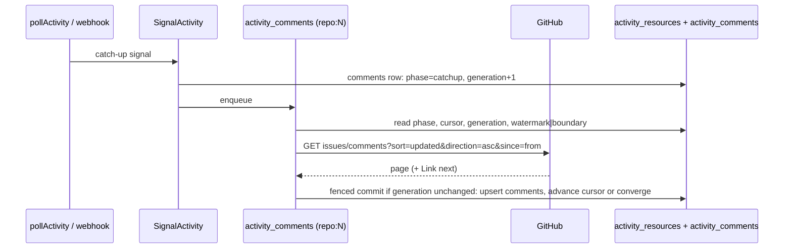

# Repo-Wide Comment Sync - Plan

## Goal Capsule

- **Objective:** A followed repository stays synchronized within GitHub's hourly rate limit, so activity analytics stay fresh and sync stops starving the signed-in user's interactive requests.
- **Means:** Replace the per-issue and per-PR comment jobs with one repo-level comment stream that lists changed comments since the last converged scan (KTD1, KTD2).
- **Authority:** Product Contract requirements win on behavior. KTDs win on mechanism. Units override neither.
- **Stop conditions:** Stop and report if GitHub's repo-wide comments endpoint does not honor `since` with `sort=updated`, or if the deletion race in KTD4 cannot be closed without per-issue locking.
- **Execution profile:** Backend only (Go, Postgres migration, sqlc). No GraphQL schema or front-end change.
- **Finish and ship:** The implementer lands all units on `feat/front-end` and runs the Verification Contract. Shipping follows the normal PR flow.

---

## Product Contract

### Summary

Comments are fetched with one paged listing per repository instead of one job per issue and per pull request. After the first sync, each catch-up asks only for comments changed since the last converged scan. Repos that already synced comments per issue drop that progress and rescan once. Reviews stay one job per pull request.

### Problem Frame

Every followed repository runs a catch-up about every 15 minutes (`pollActivity` in `backend/internal/ingestion/reconcile.go`). `SignalActivity` resets each caught-up stream with `previous_scan=NULL`. The issue and pull request syncs treat that as a first pass and re-enqueue every completed comment child through `registerChild` (`backend/internal/ingestion/schedule.go`). So every poll reruns one comment job per issue and per pull request in the 90-day window.

Each job run costs four access-check calls plus one data call. Two of those checks use the user's token (`checkActivityAccess` in `backend/internal/ingestion/refresh.go`). For the measured repository (about 205 issues and 126 pull requests), comment jobs alone cost about 1,650 calls per poll, or roughly 6,600 per hour. That exceeds the 5,000-per-hour limit, so sync falls behind and competes with the app's interactive requests.

GitHub lists a whole repository's issue and pull request conversation comments at `GET /repos/{owner}/{repo}/issues/comments`, with `since`, `sort`, and `direction` parameters. One listing replaces hundreds of jobs.

### Requirements

**Comment ingestion**
- R1. Each repository has exactly one comment stream that pages through the repo-wide comments listing. No per-issue or per-pull-request comment jobs remain.
- R2. The first scan covers comments updated since the repository's activity boundary (90 days, shared with issues). Later catch-ups cover comments updated since the last converged scan.
- R3. Each stored comment keeps its issue number, taken from the comment's `issue_url`. This covers pull request conversation comments too.
- R4. A comment or issue deleted by a signed webhook is never written back by a sync page that was fetched before the deletion.

**Coverage and status**
- R5. Analytics comment coverage and the repository's sync status read the comment stream's watermark and phase. They no longer count per-issue comment histories.
- R6. The GraphQL activity status keeps its current shape, so the web app needs no change.

**Migration**
- R7. On upgrade, existing per-issue comment progress and queued per-issue comment jobs are removed, and each repository with an activity stream gets a comment stream that starts from the boundary.

### Key Decisions

- **Catch-ups list only changed comments.** (session-settled: user-approved — chosen over listing every comment every time: a catch-up usually fits in one page, while a full listing grows with repository size on every poll.) Governs R2.
- **Drop per-issue progress and rescan once.** (session-settled: user-approved — chosen over running both paths during a migration window: the rescan costs a few pages per repository, and two writers for the same comments add code and risk.) Governs R7.
- **Reviews stay one job per pull request.** (session-settled: user-approved — chosen over GraphQL batching: GitHub has no repo-wide reviews endpoint, and batching is a larger change.)

### Scope Boundaries

- Review children, their per-PR jobs, and their coverage are unchanged.
- The per-page access checks from the installation-token fix are unchanged.
- No pruning of comments that disappear from GitHub without a webhook. No path does that today (see KTD6).

### Deferred to Follow-Up Work

- Re-enqueue a review child only when its pull request's `updated_at` changed, instead of on every catch-up. With comments fixed, reviews become the largest remaining per-poll cost (about 126 jobs per poll for the measured repository).
- Drop the `'comments'` value from the `activity_children.resource` check constraint once no code writes it.
- Set an event stream's watermark when its backfill completes, so the first catch-up starts from there instead of rescanning the window.

---

## Planning Contract

### Key Technical Decisions

- KTD1. **The comment stream reuses `syncEventResource`.** Add `comments` as a third resource beside `releases` and `issue_events` in `backend/internal/ingestion/activity_events.go`. Reuse the `activity_resources` row, phase, cursor, generation, and scan-set convergence. The `activity_comments` job kind keeps its name and switches to the `repo:<id>` key, joining `eventStreamKinds` and `activityParentKinds` in `schedule.go`. A new resource row and code path would duplicate a pattern the repo already has twice.
- KTD2. **The first page's query carries `since`.** The comment stream's initial cursor is `sort=updated&direction=asc&per_page=100&since=<from>`, where `<from>` is the stream's `watermark` when set, otherwise its `boundary`. Later pages follow GitHub's `Link` header as other streams do. `watermark` is the start time of the last converged scan, so the next scan overlaps it and misses nothing. Ascending update order means an edit during a scan moves the comment to the end, where the scan still reaches it. Implements the catch-up Key Decision (R2).
- KTD3. **A catch-up that fits in one page converges on its first run.** In `syncEventResource`'s final catch-up update, treat "started with an empty cursor and returned no next page" as converged. This is the same rule as the one-page child shortcut in `evidence_children.go`. It applies to releases and issue events too, because the code is shared. Without it, every 15-minute catch-up costs two runs even when nothing changed.
- KTD4. **Deletions bump the comment stream's generation.** `applyDeletion` already locks checkpoint rows before writing a tombstone (`lockCheckpoints` in `activity_deletion.go`). For issue and comment deletions, lock the `comments` stream row (sorted with the other streams by resource name) and increment its `generation`. A sync page fetched before the deletion then fails its generation check at commit and refetches. This replaces the current lock on the per-issue `activity_children` row. The tombstone trigger on `activity_comments` still blocks re-inserting a deleted comment id.
- KTD5. **The migration is plain SQL in one goose file.** It deletes `activity_children` rows where `resource='comments'`, deletes `activity_comments` jobs whose key contains `:parent:`, and inserts a `comments` row into `activity_resources` for every repository that has an `issues` row, copying its boundary. The next 15-minute poll enqueues the stream through `RequestActivity`. Implements the migration Key Decision (R7).
- KTD6. **The planned periodic full rescan is dropped.** The scoping discussion chose catch-ups based on `since` plus an occasional full rescan to catch deletions that webhooks miss. Research found that scan comparison never deletes rows. `previous_scan`/`current_scan` only decide convergence, and the only comment deletes are the webhook path and repository cleanup. A full rescan would therefore cost calls without removing anything. Conflict with the settled middle option: deletion repair would need new pruning logic, which is outside this scope. Re-add the rescan together with pruning if missed deletions become a measured problem.

### High-Level Technical Design

Before and after, per catch-up poll, for a repository with N issues and M pull requests in the window:

| | Comment jobs | Runs | User-token calls |
|---|---|---|---|
| Today (with the one-page child shortcut) | N + M | N + M | 2(N + M) |
| After this plan, nothing changed | 1 | 1 (KTD3) | 2 |
| After this plan, first sync | 1 | about 2–3 × ⌈comments / 100⌉ | 2 per page |

The first sync lists the window more than once. `syncEventResource` ends a backfill by switching to catch-up with no watermark, so the first catch-up rescans from the boundary, and a multi-page rescan needs a second identical scan to converge. Releases and issue events already behave this way. Setting the watermark when a backfill completes would cut this to one pass. That change is deferred because it affects all event streams.

### Assumptions

- GitHub's repo-wide comments listing returns pull request conversation comments with an `issue_url` ending in the number. Its docs say so. U1 verifies it against the fake and one live call.
- Review comments on diffs (`pull_request_review_comment`) are not stored today and remain out of scope.
- Comments last updated before the 90-day boundary are no longer fetched. Today a comment child fetches an issue's whole history. Analytics windows fall inside the boundary, so their counts are unaffected. U5 confirms this against `GetMetricCoverage`'s window parameters.

---

## Implementation Units

### U1. Repo-wide comment fetcher

- **Goal:** A GitHub client method that pages through a repository's comments using a since-based first query.
- **Requirements:** R1, R2, R3
- **Dependencies:** none
- **Files:** `backend/internal/githubapp/activity.go`, `backend/internal/githubapp/activity_test.go`, `backend/internal/githubapp/fake/fake.go`
- **Approach:**
  1. Add `IssueURL` to `IssueComment` and a repo-wide fetch method beside `FetchIssueCommentsCursor`, built on `activityPage`.
  2. Have the method accept a caller-built initial query (KTD2), because `activityPage` only defaults `per_page` today.
  3. Parse the issue number from `issue_url` and reject the page on a missing or non-numeric number, as other listings reject invalid items.
  4. Add a `/repos/{owner}/{repo}/issues/comments` handler to the fake server that honors `since`, `sort`, `direction`, and paging, and counts hits.
- **Patterns to follow:** `FetchReleasesCursor` and its validation loop; the existing per-issue comments handler in the fake.
- **Test scenarios:**
  - A page with two comments on issue 4 and one on PR 7 returns three items with issue numbers 4, 4, 7.
  - A `Link` next header returns the next cursor without `since` duplication.
  - A comment whose `issue_url` has no trailing number fails the page.
  - The fake filters out a comment updated before `since`.
- **Verification:** Unit tests pass. The fake returns PR conversation comments through the repo-wide route.

### U2. Comment stream in the event-resource sync

- **Goal:** Comments sync as a repo-level stream with since-based catch-ups and single-page convergence.
- **Requirements:** R1, R2, R3
- **Dependencies:** U1
- **Files:** `backend/internal/ingestion/activity_events.go`, `backend/internal/ingestion/schedule.go`, `backend/internal/ingestion/refresh.go`, `backend/internal/ingestion/activity_events_integration_test.go`
- **Approach:**
  1. Add the `comments` branch to `syncEventResource` (KTD1). Build the first cursor from `watermark` or `boundary` (KTD2), and upsert with the existing `activity_comments` statement from `evidence_children.go`.
  2. Add `SyncComments` for the repo key, add the kind to `eventStreamKinds` and `activityParentKinds`, and insert the `comments` row in `RequestActivity`.
  3. Apply the one-page convergence rule to the shared catch-up update (KTD3).
  4. Re-register the handler in `refresh.go`.
- **Patterns to follow:** The `releases` branch of `syncEventResource`.
- **Test scenarios:**
  - Backfill with 150 comments takes two pages, then a catch-up converges in one run with phase `current` and watermark set.
  - A catch-up after a comment edit requests `since=<watermark>` and updates the stored body.
  - A catch-up with no changes is one data call and one job run.
  - Releases still converge after a multi-page catch-up that shifted between pages (two scans required).
  - A rate-limited page defers with the provider's retry time and leaves the cursor unchanged.
- **Verification:** The integration tests pass, and the call-count test shows one comments listing per catch-up.

### U3. Stop registering comment children

- **Goal:** Issue and pull request syncs no longer create comment work.
- **Requirements:** R1
- **Dependencies:** U2
- **Files:** `backend/internal/ingestion/sync.go`, `backend/internal/ingestion/evidence_pull_requests.go`, `backend/internal/ingestion/evidence_children.go`, `backend/internal/ingestion/schedule.go`, `backend/internal/ingestion/evidence_integration_test.go`, `backend/internal/ingestion/sync_integration_test.go`
- **Approach:**
  1. Remove the `registerChild(..., "comments", ...)` calls.
  2. Drop the comment branch from `syncChild` and the `commentFetcher` interface, leaving reviews only.
  3. Remove `FetchIssueCommentsCursor` and its fake route if nothing else uses them.
- **Test scenarios:**
  - Syncing a page of issues creates no `activity_children` rows.
  - Syncing a page of pull requests creates only review children.
  - Existing review-child tests still pass unchanged.
- **Verification:** `grep` finds no `"comments"` child registration. Integration tests pass.

### U4. Deletion race on the comment stream

- **Goal:** Webhook deletions invalidate in-flight comment pages.
- **Requirements:** R4
- **Dependencies:** U2, U3
- **Files:** `backend/internal/ingestion/activity_deletion.go`, `backend/internal/ingestion/webhook_activity_integration_test.go`
- **Approach:** Per KTD4, add `comments` to the locked streams for issue and comment deletions, bump its generation, and remove the per-issue `activity_children` lock and delete.
- **Execution note:** Start with a failing integration test that deletes a comment between the fetch and the commit.
- **Test scenarios:**
  - A comment deleted by webhook while its page is in flight is absent after the sync job finishes, and the job refetched.
  - An issue deleted by webhook removes its comments, and an in-flight page does not restore them.
  - A deletion for a repository with no comment stream row still writes the tombstone.
- **Verification:** The race tests pass with the transport hook pattern from `zz_callcount_integration_test.go` (`afterActivityFetch`).

### U5. Coverage and status read the stream

- **Goal:** Analytics coverage and sync status use the comment stream.
- **Requirements:** R5, R6
- **Dependencies:** U2
- **Files:** `backend/queries/analytics.sql`, `backend/internal/db/` (sqlc output), `backend/internal/analytics/analytics.go`, `backend/graphql/status.go`, `backend/graphql/evidence_integration_test.go`
- **Approach:**
  1. In `GetMetricCoverage`, replace the `issue_children` and `comment_children` CTEs with the comment stream's boundary and watermark, as releases do.
  2. Adjust `analytics.go` to treat comment coverage like a stream.
  3. In `status.go`, build the comments `ChildResourceStatus` from the comment stream row (`Complete` when phase is `current` and fresh, `PendingChildren` 0) so the GraphQL shape holds.
  4. Regenerate sqlc.
- **Test scenarios:**
  - A repository whose comment stream converged reports comments complete and comment coverage through its watermark.
  - A repository mid-backfill reports comments incomplete with the stream's failure code and next attempt time.
  - Review status is unchanged.
- **Verification:** GraphQL evidence tests pass, and `make check` reports no generated-code drift.

### U6. Migration

- **Goal:** Existing installations move to the comment stream once.
- **Requirements:** R7
- **Dependencies:** U2, U3
- **Files:** `backend/migrations/00016_repo_wide_comments.sql`, `backend/internal/ingestion/activity_migration_integration_test.go`
- **Approach:** KTD5. Include a goose Down that deletes the `comments` stream rows (per-issue rows are not restored; a rollback rescans).
- **Test scenarios:**
  - A database with per-issue comment children and queued `:parent:` comment jobs ends with neither, plus one `comments` stream row per repository with an `issues` row, sharing its boundary.
  - Stored `activity_comments` rows survive the migration.
  - The next `SignalActivity` enqueues `activity_comments` with key `repo:<id>`.
- **Verification:** The migration test passes on a fresh and on a populated database.

---

## Verification Contract

| Gate | Command | Applies to |
|---|---|---|
| Format, vet, codegen drift | `make check` | All units |
| Unit tests | `cd backend && go test ./...` | U1 |
| Integration tests | `make test-integration` (Postgres on `localhost:54329`) | U2–U6 |
| Call budget | The call-count test in `backend/internal/ingestion/zz_callcount_integration_test.go`, extended to assert one comments listing and no per-issue comment calls per catch-up | U2, U3 |

---

## Definition of Done

- Every unit's test scenarios exist and pass.
- A catch-up of an unchanged repository makes one comment data call and no per-issue comment calls.
- No code path creates `activity_children` rows with `resource='comments'`.
- `make check` and `make test-integration` pass.
- Abandoned-attempt code is removed from the diff.
